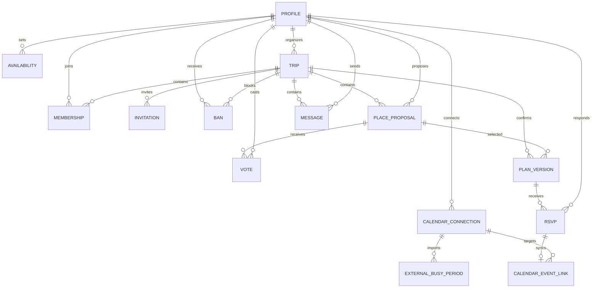

# ต้นแบบระบบใหม่ — WePlanGo

สถานะ: เว็บต้นแบบข้อมูลจำลองแยกจากระบบจริง การเปิด `/mockup` ไม่เปลี่ยนข้อมูลหรือสิทธิ์จริง ระบบจริงที่พัฒนาจากแบบนี้อยู่ที่ `/trips` และอธิบายใน [WORKSPACE.md](WORKSPACE.md)

## เปิดทดลองและแก้ไข

รัน `npm.cmd install` หากยังไม่มี dependencies จากนั้น `npm.cmd run dev` แล้วเปิด <http://localhost:3000/mockup> ไม่ต้องตั้งค่า Supabase หรือ Google OAuth

โค้ด UI อยู่ที่ `src/features/mockup/MockupApp.tsx` ข้อมูลตั้งต้นและกติกาอยู่ที่ `src/features/mockup/model.ts` ส่วนรูปแบบที่ใช้ร่วมกับระบบจริงอยู่ที่ `src/components/ui/workspace.css` ข้อมูลทดลองบันทึกเฉพาะ localStorage คีย์ `weplango-mockup-v1` ใน browser origin เดียวกัน ไม่มีการส่งข้อความหรือข้อมูลปฏิทินออกภายนอก

ปุ่มเข้าสู่ระบบเป็นการจำลอง เปิด “เครื่องมือทดสอบ” ด้านบนเพื่อเลือกผู้ใช้พิม (หัวห้องตัวอย่าง) นนท์ หรือเมย์ ทุกบัญชีใช้ข้อมูลชุดเดียวกันในหน้าที่เปิดอยู่ การสลับบทบาทไม่ใช่การตรวจสิทธิ์จริง ในเมนูเดียวกันมีสถานการณ์คะแนนเสมอ วันชนกัน ยังไม่มีคำตอบ ลิงก์ใช้ไม่ได้ และซิงก์ล้มเหลว การโหลดสถานการณ์หรือรีเซ็ตจะแทนที่ข้อมูลทดลองหลังยืนยัน

## รูปแบบต้นแบบ

ธีมใหม่ใช้พื้นฟ้าอ่อน `#f1f6fc` หมึกกรมท่า `#182d52` ปุ่มน้ำเงิน `#245bdb` เส้นแบ่ง `#dce5f1` และส้มแสงอาทิตย์ `#ffb75b` วันว่างใช้เขียวพร้อมเครื่องหมายถูก วันไม่ว่างใช้ชมพูพร้อมกากบาท จึงแยกสถานะได้โดยไม่พึ่งสีอย่างเดียว

ใช้ IBM Plex Sans Thai ที่เก็บใน `public/mockup/` ขนาดเนื้อหาหลัก 16px และไอคอน SVG เส้นชุดเดียวกันจาก `Icon.tsx` มีคำสั้นกำกับปุ่มที่สำคัญ ส่วนปฏิทินใช้ไอคอนแทนการเขียนสถานะซ้ำทุกช่อง และคงชื่อสถานะเต็มใน accessible name

ภาพเป็นภาพบรรยากาศตัวอย่าง ไม่ใช่ภาพยืนยันของสถานที่ทุกข้อเสนอ ใช้ในหน้ารวมทริป ปกห้อง และข้อเสนอตัวอย่าง ข้อเสนอใหม่ที่ไม่มีภาพแสดงไอคอนสถานที่แทน หน้ามือถือย่อส่วนหัวและซ่อนภาพปกเมื่อเข้าหน้าทำงาน เพื่อให้เห็นปฏิทินหรือที่เที่ยวเร็วขึ้น การออกแบบนี้แยกจาก `DESIGN.md` ของระบบปัจจุบัน

แหล่งภาพ: Ash Edmonds, [ภูเขาเชียงใหม่](https://unsplash.com/photos/landscape-photo-of-mountains-mXBZo6PvjMk) และ [ดอยอินทนนท์](https://unsplash.com/photos/landscape-photography-of-mountains-v0Qujn-zHJk) บน Unsplash ฟอนต์มาจาก [Google Fonts IBM Plex Sans Thai](https://github.com/google/fonts/tree/main/ofl/ibmplexsansthai) เก็บใบอนุญาตที่ `public/mockup/OFL.txt` ภาพและฟอนต์ให้บริการจากโปรเจกต์ทั้งหมด ไม่มีการดึง asset ภายนอกขณะใช้งาน

## ปรับ flow หลังทดลองใช้งาน

- สร้างห้องด้วยชื่อทริป รายละเอียด ช่วงวันที่ และเวลาปิดโหวตอยู่ใน “รายละเอียดเพิ่มเติม” พร้อมค่าเริ่มต้นที่แก้ได้
- เปิดห้องใหม่แล้วแสดงลิงก์และปุ่ม “คัดลอกคำเชิญ” ทันที เมื่อคัดลอกสำเร็จจะเปิดปฏิทินให้อัตโนมัติ โดยไม่ถือว่ามีเพื่อนเข้าร่วมแล้ว
- แท็บ “ทริป” แนะนำงานตามข้อมูลจริง: ชวนเพื่อน → ระบุวันว่างในช่วงทริป → เสนอสถานที่/โหวต → ปิดโหวตและสรุป → ตอบรับ สมาชิกไม่มีปุ่มปิดโหวต
- ปฏิทินมีปุ่มไปเลือกที่เที่ยว หน้าโหวตมีปุ่ม “สรุปทริป” ของหัวห้องโดยตรง ไม่ต้องกลับหน้าเริ่มต้นก่อน ฟอร์มสรุปแผนปรากฏหลังยืนยันปิดโหวตเท่านั้น และการยืนยันแผนครั้งแรกไม่มีกล่องถามซ้ำ เมื่อแก้แผนเดิมยังเตือนผลกระทบต่อ RSVP
- พับภาพรวมขั้นตอน รายละเอียดห้อง ผลโหวต รายชื่อคนว่าง และเครื่องมือทดสอบไว้จนกว่าจะเปิด ลดข้อความซ้ำและแยกแชทออกจากงานหลัก โดยยังเข้าแต่ละฟีเจอร์ตรงจากแท็บได้
- การข้ามแท็บทำได้ตามเดิม คำแนะนำเป็นตัวช่วย ไม่บังคับลำดับหรือเปลี่ยนกติกาคะแนนและ RSVP

ภาพตัวอย่าง: [หน้ารวมทริป](mockup/home.png), [ห้องบนคอมพิวเตอร์](mockup/desktop.png), [ห้องบนมือถือ](mockup/mobile.png), [ปฏิทินมือถือ](mockup/calendar-mobile.png), [โหวตบนมือถือ](mockup/voting-mobile.png) และ [โหวตบนคอมพิวเตอร์](mockup/voting-desktop.png)

### ช่องกรอกและตัวเลือกเดือน

ช่องข้อความใช้พื้นฟ้าอ่อน `#f7faff` ขอบ `#d5e1f2` มุม 12px และขอบโฟกัสสีน้ำเงิน มีสถานะ hover, readonly, disabled และ validation แยกกัน Textarea ปรับความสูงได้ Select ใช้ลูกศรในชุดไอคอนเดียวกัน ช่องกรอกบนมือถือใช้ตัวอักษร 16px

ตัวเลือกเดือนใน `src/features/mockup/MonthPicker.tsx` แทน native month input ด้วยปุ่มเลื่อนเดือนและแผงเลือกเดือนภาษาไทย/ปี พ.ศ. ค่าใน state ยังคงเป็น `YYYY-MM` ค.ศ. ปุ่มลูกศรเลื่อนข้ามปีได้ แผงเดือนใช้ลูกศรคีย์บอร์ด Home/End และ Enter เพื่อเลือก Escape ปิดและคืนโฟกัส ปิดได้เมื่อคลิกภายนอกหรือ Tab ออก รองรับ reduced motion และไม่ล้นหน้าจอ 320px

ภาพ: [ช่องข้อความขณะโฟกัส](mockup/fields-desktop.png) และ [ตัวเลือกเดือนบนมือถือ](mockup/month-mobile.png) สคริปต์ตรวจ UX เพิ่มกรณีข้ามธันวาคม–มกราคม เลือกปี/เดือน จำนวนวันกุมภาพันธ์ การคืนโฟกัส และช่อง required แล้ว

## เส้นทางตรวจรับ

1. เข้าสู่ระบบจำลอง → สร้างทริป → คัดลอกคำเชิญจากแท็บ “ทริป” → เลือกวันได้ทันที
2. สลับเป็นนนท์ → เข้าร่วมด้วยลิงก์ → ระบุวันว่าง → ไป Profile เพื่อตรวจว่าคำตอบตรงกัน
3. เสนอสถานที่ → โหวตหลายแห่ง → สลับบัญชีในเครื่องมือทดสอบเพื่อลองคะแนนสมาชิกคนอื่น
4. สลับเป็นหัวห้อง → “สรุปทริป” → ยืนยันปิดโหวต → หากเสมอเลือกได้เฉพาะผู้ได้คะแนนสูงสุด → ยืนยันวันและสถานที่
5. สลับสมาชิก → ตอบรับ → เปิด Profile เพื่อตรวจนัด → เชื่อม Google จำลองและดูสถานะส่งนัด
6. เปลี่ยนแผนโดยหัวห้อง → ตรวจว่าคำตอบรับเดิมถูกถอน → ตอบรับใหม่ → ตรวจว่านัดมีหนึ่งรายการต่อทริปและวันที่ล่าสุด
7. ทดลองส่งแชท เตะ/แบน/ปลดแบน ปิด/สร้างลิงก์ใหม่ และลบห้อง ตรวจว่าผู้ถูกแบนเข้าซ้ำไม่ได้ ผู้ถูกเตะกลับเข้าด้วยลิงก์ที่ใช้งานได้

## กติกาและขอบเขต

- หนึ่งห้องต่อหนึ่งทริป ทุกคนเสนอและโหวตได้หลายสถานที่ คนละหนึ่งคะแนนต่อสถานที่ แก้ไขได้ก่อนเวลาปิดโหวต (เวลาไทย) หรือก่อนหัวห้องปิดเอง
- หัวห้องยืนยันวันภายในช่วงวันที่ตั้งไว้ โดยดูปฏิทินประกอบ ไม่ต้องเป็นวันที่ทุกคนว่าง สถานที่ต้องเป็นผู้ชนะหรือหนึ่งในผู้ได้คะแนนนำเท่ากัน ถ้ายังไม่มีคะแนนจะยืนยันไม่ได้
- วันว่าง/ไม่ว่างกลางอัปเดตจาก Profile หรือห้องได้ วันที่ไม่ระบุหมายถึงยังไม่ตอบ แสดงวันทั้งวัน ยังไม่รองรับช่วงชั่วโมงหรือทริปหลายวันในต้นแบบนี้
- Google จำลองมีนัดส่วนตัวทุกวันที่ 15 ของเดือน โดยบล็อกการระบุว่าว่างทับ สมาชิกอื่นเห็นเฉพาะสถานะ ไม่เห็นชื่อกิจกรรม นัดทริปที่ตอบรับแล้วบล็อกวันเช่นกัน
- เมื่อเปลี่ยนแผน จะถอน RSVP และนัดของแผนเดิมจนผู้ใช้ตอบรับใหม่ นัด Google เป็นเพียงสถานะจำลองที่คำนวณจากข้อมูลเดียวกับ Profile ไม่มี OAuth หรือการซิงก์เครือข่ายจริง
- เตะ/แบนถอนคะแนนและ RSVP ของบุคคลนั้น เก็บประวัติข้อความไว้ หัวห้องไม่สามารถเตะตัวเองได้ ลบห้องแล้วนัดทั้งหมดของห้องหายไปด้วย
- รูป Profile เป็น PNG/JPEG/WebP ไม่เกิน 1 MB เก็บใน browser เท่านั้น ข้อมูลอาจหายหากล้าง storage หรือเปิดคนละ browser ลิงก์เชิญต้องใช้กับข้อมูลจำลอง origin เดียวกัน ไม่ใช่คำเชิญข้ามอุปกรณ์จริง

## โครงสร้างข้อมูลเบื้องต้นสำหรับระบบจริงภายหลัง

แผนภาพนี้อธิบายความสัมพันธ์ ยังไม่ใช่ SQL schema หรือข้อสรุป API การออกแบบ production ต้องแยกตรวจ OAuth scopes, token storage, RLS, timezone, การ retry และการลบข้อมูลเพิ่มเติม



Production ควรมี event link ที่อ้างถึงทริป ผู้ใช้ และ external event ID อย่างเสถียรเพื่ออัปเดตนัดเดิม ป้องกันสร้างซ้ำ และถอนนัดเมื่อเปลี่ยนแผน/ถอนตอบรับ ต้นแบบคำนวณรายการนัดจาก trip ID กับ RSVP ของ plan version ล่าสุดแทนการสร้างตารางจริง

## ผลตรวจรับต้นแบบ — 20 ตุลาคม 2026

- `npm.cmd run lint`: ผ่าน ไม่มี warnings
- `npm.cmd test`: ผ่าน 8 tests รวมกติกาคะแนนเสมอ การยืนยันแผน RSVP ตาม plan version การเตะ/แบน และคำเชิญ
- `npm.cmd run build`: ผ่าน `/mockup` สร้างเป็น static route ได้
- Playwright กับ Chrome headless และ timezone Asia/Bangkok: ผ่านทั้งเส้นทางสร้างห้อง → เชิญ → เข้าร่วม → เสนอ → โหวต → ยืนยัน → RSVP และการเปลี่ยนแผน/ถอนนัดเก่า/ตอบรับใหม่/ลองซิงก์อีกครั้ง/ลบห้อง
- ผ่านการเก็บข้อมูลหลังรีเฟรช ส่งข้อความ ป้องกันบัญชีถูกแบนเข้าซ้ำ และวันว่างตรงกันระหว่างห้องกับ Profile ไม่พบ JavaScript page errors ในเส้นทาง smoke test
- ตรวจภาพ desktop 1440px และ mobile 390px ไม่ล้นหน้าจอแนวนอน ทดสอบ Tab/Escape ในกล่องยืนยัน และลูกศรสลับแท็บ
- ตัวตรวจ design แจ้ง advisory ว่าสี ขนาดตัวอักษร และมุมโค้งต่างจาก DESIGN.md เดิม ซึ่งเป็นการแยก visual prototype โดยตั้งใจตามหัวข้อรูปแบบต้นแบบด้านบน

การตรวจนี้ใช้บัญชีจำลองสองคนใน browser context เดียวกัน ไม่ใช่ E2E ของ OAuth, Google Calendar หรือฐานข้อมูล production และไม่ได้รัน database tests เพราะไม่มีการเปลี่ยน DB

รอบปรับ flow: tests เพิ่มเป็น 10 รายการ ครอบคลุมลำดับคำแนะนำ สิทธิ์ของหัวห้อง/สมาชิก และวันว่างที่อยู่นอกช่วงทริป ตรวจเบราว์เซอร์ใหม่ตั้งแต่สร้างห้องจนตอบรับและเห็นนัดใน Profile รวมถึงการพับตัวเลือกและไม่มีฟอร์มยืนยันก่อนปิดโหวต อัปเดตภาพหน้าจอทั้งสองขนาดให้เป็นหน้าหลังสร้างห้องใหม่

## ผลทดสอบธีมใหม่และจำนวนคลิก

ทดสอบด้วย Chrome/Playwright จำลองสองบัญชีบนหน้าจอจริงของต้นแบบ ไม่ใช่การศึกษากับผู้ใช้จริง แบ่งงานหลักเป็นสร้างห้องและชวนเพื่อน → เลือกวัน → เลือกที่เที่ยว → สรุปและตอบรับ

| ผู้ใช้ | เส้นทางที่นับ | คลิก |
| --- | --- | --- |
| หัวห้อง | เปิดฟอร์มสร้าง → สร้าง → คัดลอกคำเชิญ → เลือกวัน → ไปที่เที่ยว → เพิ่มข้อเสนอ → เลือก → สรุป → ยืนยันปิดโหวต → ยืนยันแผน | 10 |
| สมาชิกที่มีวันว่างใน Profile | เปิดช่องคำเชิญ → เข้าร่วม → ไปที่เที่ยว → เลือก → ตอบรับแผน | 5 |
| สมาชิกที่ยังไม่เคยระบุวันว่าง | เปิดช่องคำเชิญ → เข้าร่วม → ไปปฏิทิน → เลือกวัน → ไปที่เที่ยว → เลือก → ตอบรับแผน | 7 |

ตัวเลขไม่นับการเข้าสู่ระบบจำลอง การพิมพ์ข้อมูล การสลับบัญชีของผู้ทดสอบ และการเปิดหน้าสำหรับตรวจผล หัวห้องมี 1 สถานที่ที่เสนอเองและเลือก 1 วัน หากเพิ่มหลายสถานที่หรือหลายวันจำนวนคลิกจะเพิ่มตามจริง ดูผลที่เครื่องบันทึกใน [บัญชีมีวันว่างแล้ว](mockup/ux-check.json) และ [บัญชีเริ่มใหม่](mockup/ux-check-fresh.json)

ตรวจแล้วว่าไม่ต้องกลับแท็บเริ่มต้นระหว่างเลือกวันกับเลือกที่เที่ยว การคัดลอกคำเชิญเปิดปฏิทินให้โดยตรง สมาชิกไม่เห็นปุ่มสรุป การเผยแพร่แผนครั้งแรกไม่มีหน้าต่างยืนยันซ้ำ นัดยังอยู่หลังรีเฟรช ไอคอนส่งแชทมี accessible name สลับแท็บด้วยลูกศรได้ รูปและฟอนต์โหลดได้โดยไม่เรียกบริการภายนอก และไม่ล้นแนวนอนที่ 320/390/768/1440px

รันทดสอบซ้ำได้โดยเปิด dev server แล้วใช้ PowerShell:

```powershell
npm.cmd install --prefix "$env:TEMP/weplango-browser-qa" playwright --no-package-lock --no-audit --no-fund
$env:MOCKUP_PLAYWRIGHT_MODULE = "$env:TEMP/weplango-browser-qa/node_modules/playwright/index.mjs"
node scripts/check-mockup-ux.mjs
$env:MOCKUP_FRESH_MEMBER = "1"
node scripts/check-mockup-ux.mjs
Remove-Item Env:MOCKUP_FRESH_MEMBER
```

ต้องมี Google Chrome ในเครื่อง สคริปต์ใช้ browser context ใหม่และข้อมูลจำลอง ไม่แตะข้อมูลใน browser ที่ผู้ใช้เปิดอยู่ กำหนด `MOCKUP_URL` ได้หากใช้พอร์ตอื่น ผลทดสอบและภาพหน้าจอจะเขียนทับไฟล์ใน `docs/mockup/`
