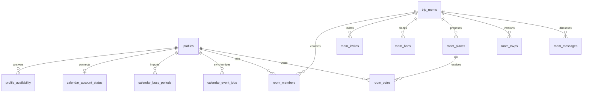

# WePlanGo — ระบบห้องทริปจริง

สถานะ 22 ตุลาคม 2026: เปิดใช้ระบบใหม่ที่ https://weplango-napat6.vercel.app แล้ว ผู้ใช้ยืนยัน Google Login และสถานะ Calendar บน production ผ่าน ทดสอบ flow สองบัญชีชั่วคราวบน production และซิงก์ Google จริงผ่าน Cron สำเร็จ ดู [ผลตรวจรับ](production/ACCEPTANCE.md)

## เปิดใช้งาน

ตั้งค่า `.env.local` ตาม `.env.example` แล้วรัน `npm.cmd run dev` เปิด <http://localhost:3000> เข้าด้วย Google หน้า `/trips` แสดงห้องของผู้ใช้ `/trips/new` สร้างห้อง `/profile` แก้ชื่อ รูป และวันว่าง `/join` รับลิงก์เชิญ ส่วน `/mockup` ยังคงเป็นข้อมูลจำลองในเบราว์เซอร์

หน้า `/groups` และ `/notifications` รุ่นก่อนส่งต่อไปหน้ารวมทริป ลิงก์ `/trips/[id]` เดิมยังใช้ UUID เดิมที่ย้ายมาได้ ตัว UI ไม่มีการสลับบัญชีจำลอง และไม่เก็บข้อมูลจริงใน localStorage

## กติกา

- หนึ่งห้องต่อหนึ่งทริป หัวห้องเป็นสมาชิกเสมอ ทุกคนเสนอสถานที่และเลือกได้หลายแห่ง คนละหนึ่งคะแนนต่อสถานที่ หัวห้องไม่มีคะแนนพิเศษ
- โหวตและเสนอได้เฉพาะก่อน deadline และก่อนหัวห้องปิดโหวต ฐานข้อมูลตรวจซ้ำทุกคำสั่ง หัวห้องยืนยันได้เฉพาะสถานที่คะแนนสูงสุดที่มีคะแนนอย่างน้อยหนึ่ง หากเสมอเลือกได้เฉพาะกลุ่มที่เสมอ
- วันว่างเป็นข้อมูลส่วนตัวกลาง แก้จาก Profile หรือห้องแล้วใช้คำตอบเดียวกัน วันที่ไม่ระบุคือยังไม่ตอบ ช่วงติดธุระจาก Google และนัดทริปที่ตอบรับมีผลเป็นไม่ว่าง สมาชิกห้องเห็นเพียงสถานะรายวัน ไม่เห็นรายละเอียดกิจกรรมส่วนตัว
- หัวห้องเลือกวันภายในช่วงทริปโดยดูจำนวนคนว่าง ทุกแผนยืนยันมี `plan_version` เมื่อเปลี่ยนแผนต้องตอบรับใหม่ คำตอบเก่าคงเป็นประวัติและไม่นับในแผนใหม่
- ตอบรับแล้วนัดปรากฏใน Profile ทันที และเข้าคิว Google หากเชื่อมต่ออยู่ หนึ่งผู้ใช้ต่อหนึ่งห้องมี event job เดียว อัปเดต event เดิมตาม revision เมื่อเปลี่ยนแผน ไม่มีการส่งคำเชิญอีเมลให้บุคคลอื่น
- แชทเป็นข้อความตัวอักษร ผู้ส่ง เวลา และข้อความระบบ โหลดล่าสุด 100 ข้อความ หน้าเปิดอยู่ตรวจข้อมูลใหม่ทุก 10 วินาที จึงไม่ใช่ realtime socket
- เตะแล้วกลับเข้าด้วยคำเชิญที่ใช้ได้ แบนแล้วเข้าซ้ำไม่ได้จนปลดแบน หัวห้องเพิกถอน/สร้างลิงก์ใหม่และลบห้องได้ การลบมี dialog ยืนยันและเข้าคิวถอนนัด Google ก่อนข้อมูลห้องถูกลบ

## โครงสร้างและขอบเขตข้อมูล



แผนปัจจุบันอยู่บน `trip_rooms` (`selected_date`, `selected_place_id`, `plan_version`) RSVP ใช้คีย์ `(room_id,user_id,plan_version)` ส่วน `calendar_event_jobs` ใช้ `(user_id,room_id)` โดยตั้งใจไม่มี FK ไปห้อง เพื่อให้ถอนนัดหลังลบห้องได้ เก็บ OAuth token ที่เข้ารหัส AES-256-GCM ใน `private.calendar_credentials` เท่านั้น คีย์เข้ารหัสอยู่ฝั่ง server

ตาราง public รุ่นใหม่เปิด RLS และให้ browser อ่านได้ตามสิทธิ์ การเปลี่ยนข้อมูลผ่าน RPC `room_command`, `calendar_command` และคำสั่งฝั่ง server ตรวจผู้ใช้ สมาชิก หัวห้อง deadline และ plan version SQL functions ที่ข้าม RLS อยู่ใน private schema พร้อมจำกัด EXECUTE/search_path รูปเก็บใน Storage `profile-avatars` จำกัด 1 MB และเฉพาะ PNG/JPEG/WebP ผู้ใช้เขียนได้เฉพาะ folder ของตนเอง

โค้ด: `src/features/trips/Workspace.tsx` เป็น UI, `workspace-data.ts` โหลดข้อมูล, `workspace-actions.ts` เป็น Server Actions, `src/features/calendar/` เป็น OAuth token encryption และ sync ส่วน controls ใช้ร่วมกับต้นแบบใน `src/components/ui/`

## การย้ายข้อมูล

Migration `room_workspace` คัดลอก trip UUID เดิม หัวห้อง สมาชิกที่ยังไม่ปฏิเสธ ข้อเสนอ คะแนน RSVP และคำเชิญไปตารางใหม่ โดยแปลงคำตอบวันเป็น free/busy ระดับ Profile หากข้อมูลต่างห้องชนกันใช้ busy ก่อน คำเชิญกลุ่มเก่ามองเป็นรายการห้องให้เลือก

ตาราง/API รุ่นก่อนยังคงไว้เพื่อย้อนตรวจข้อมูล ไม่ใช่แหล่งข้อมูลของ UI ใหม่ และไม่ได้ซิงก์สองทาง ห้ามเปิด UI รุ่นเก่าให้แก้ข้อมูลระหว่าง cutover เพราะจะทำให้ข้อมูลสองชุดไม่ตรงกัน ก่อน deploy ต้องตรวจว่ามีข้อมูล legacy เพิ่มหลัง migration หรือไม่และทบทวน cutover อีกครั้ง ห้ามนำ migration คัดลอกข้อมูลไปรันซ้ำหรือ reset remote database

## Google Calendar

Google Login และเชื่อม Calendar เป็นคนละ flow:

| การตั้งค่า | ค่า local |
| --- | --- |
| Google OAuth URI สำหรับ Supabase Login | `https://deondfdbovycllaxfuag.supabase.co/auth/v1/callback` |
| Supabase Auth Redirect URLs | `http://localhost:3000/**` รวม callback และ query `next` |
| Google OAuth URI สำหรับ Calendar | `http://localhost:3000/api/calendar/callback` |
| `APP_URL` | `http://localhost:3000` |

เปิด Calendar API ใน Google Cloud เพิ่ม Test users หาก Audience ยังเป็น Testing และเพิ่ม scopes `https://www.googleapis.com/auth/calendar.events.owned` กับ `https://www.googleapis.com/auth/calendar.freebusy` แล้วใส่ `GOOGLE_CALENDAR_CLIENT_ID`, `GOOGLE_CALENDAR_CLIENT_SECRET` ใน env ฝั่ง server ผู้ใช้กดเชื่อมใน Profile และอนุญาตสิทธิ์เอง

หาก Login กลับ production ให้ตรวจ Supabase Redirect URLs หากกลับ `/auth/error` พร้อม `Unable to exchange external code` ให้ดู Auth logs ก่อน เมื่อ Google ระบุ `invalid_client` / `The provided client secret is invalid` ต้องแก้ Client ID/secret ใน Supabase Google Provider ให้ตรงกับ OAuth Web Client ที่ยังใช้งานอยู่ การแก้ `.env.local` เปลี่ยนเฉพาะ Calendar flow ไม่เปลี่ยน secret ที่ Supabase ใช้ Login

`CALENDAR_TOKEN_KEY` ต้องเป็น random 32 bytes แบบ base64 เก็บถาวรและสำรองอย่างปลอดภัย ห้ามสุ่มใหม่ทุก deploy มิฉะนั้น token ที่บันทึกแล้วถอดรหัสไม่ได้ ส่วน `SUPABASE_SERVICE_ROLE_KEY` และ `CRON_SECRET` ใช้เฉพาะ worker ฝั่ง server ไม่ใช้ใน browser

หน้าเปิดอยู่ซิงก์ทุก 60 วินาที และซิงก์เมื่อ RSVP สำหรับงานขณะผู้ใช้ออกจากเว็บ มี `pg_cron` เรียก `/api/calendar/cron` ทุก 5 นาที ผ่าน `pg_net` อ่าน URL และ bearer secret จาก Vault หากยังไม่ตั้ง Vault จะไม่ส่ง request ออกไป:

1. Deploy app ไป HTTPS และตั้ง env ทั้ง Google, encryption key, service-role key และ random `CRON_SECRET` อย่างน้อย 32 ตัวอักษร
2. เพิ่ม production Calendar callback ใน Google และ production Login callback ใน Supabase
3. ใน Supabase Vault สร้าง secret ชื่อ `weplango_calendar_worker_url` ค่า `https://YOUR-DOMAIN/api/calendar/cron` และ `weplango_calendar_worker_secret` ค่าเดียวกับ `CRON_SECRET` บน server
4. ตรวจ Cron job `weplango-calendar-sync`, ประวัติ HTTP response และ `calendar_account_status.error` หลังตอบรับแผนแล้วปิดเว็บ

Worker ใช้ lease ป้องกันงานซ้อน ตรวจ revision ก่อน acknowledge และ retry เมื่อผิดพลาด นำเข้าเฉพาะ free/busy ของ primary calendar ช่วงย้อนหลัง 30 วันถึงอนาคต 730 วัน ไม่มีชื่อหรือรายละเอียดกิจกรรม Google ในข้อมูลที่แชร์ให้สมาชิก

เอกสารอ้างอิง: [Supabase redirect URLs](https://supabase.com/docs/guides/auth/redirect-urls), [Google OAuth web server](https://developers.google.com/identity/protocols/oauth2/web-server), [Google Calendar API](https://developers.google.com/workspace/calendar/api/quickstart/js), [Supabase Cron](https://supabase.com/docs/guides/cron/quickstart)

## หลักฐานและสิ่งที่ต้องตรวจต่อ

รัน browser check ซ้ำโดยตั้ง service-role key เฉพาะฝั่ง server และติดตั้ง Playwright ภายนอกแอป ตั้ง `MOCKUP_PLAYWRIGHT_MODULE` เป็น path ของ `playwright/index.mjs` แล้วรันคำสั่งต่อไปนี้ขณะ local server เปิดอยู่:

```powershell
node scripts/workspace-fixture.mjs create
try {
  node scripts/check-workspace.mjs
  node scripts/check-planning.mjs
}
finally { node scripts/workspace-fixture.mjs remove }
```

ใช้บัญชีชั่วคราวสามบัญชีผ่าน Auth Admin API รหัสผ่านสุ่มอยู่ในไฟล์ temp ไม่พิมพ์ออก log ขั้นตอนลบตรวจ marker ของบัญชีทดสอบก่อนและไม่แตะบัญชีจริง รอบ production ถอน session ลบรูป/บัญชี/ไฟล์ temp ครบแล้ว ตั้ง `WORKSPACE_URL=https://weplango-napat6.vercel.app` เพื่อทดสอบ deployment แทน localhost โดยต้องใช้ server secret ของ environment นั้น

- `npm.cmd run lint`, `npm.cmd test` (23 tests) และ `npm.cmd run build` ผ่าน
- Browser test `scripts/check-workspace.mjs` ใช้ temporary accounts กับ Supabase จริง ตรวจสร้าง/เชิญ/วันว่าง/สองบัญชีโหวต/คนนอกอ่านไม่ได้/ยืนยัน/RSVP หลัง reload/ชื่อ/Storage รูป/เปลี่ยนแผนถอนนัดเก่า/แชท/แบน/ปลดแบน/ลบ ผ่าน ดู [รายงาน](production/check.json), [desktop](production/desktop.png), [mobile](production/mobile.png)
- SQL assertions 13 ไฟล์รันใน transaction และ rollback; tests 11–13 ครอบคลุมกติกาห้อง calendar outbox และลำดับ worker ที่ไม่ปล่อยให้บัญชีซิงก์ล้มเหลวขวางบัญชีอื่น tests 01–10 ตรวจ compatibility ของ legacy ปรับ test การตอบเชิญให้ใช้ RPC ปัจจุบัน และสร้าง historical fixture ก่อนเปิด date guard กลับ
- OAuth redirect/PKCE/callback และ invalid state ตรวจผ่าน ผู้ใช้ยืนยัน Google Login และ Profile เชื่อมต่อบน production วันที่ 22 ตุลาคม 2026
- Calendar transport tests จำลอง lost acknowledgement, insert conflict, ambiguous 409/404, tombstone, revision change และ retry การถอนนัด ผ่าน เมื่อ 409 ตามด้วย 404 จะเก็บ event ID เดิมแล้ว retry เพื่อไม่สร้างนัดซ้ำจากคำตอบที่ยังไม่ชัดเจน
- Google consent, อ่าน busy จากกิจกรรมจริง, สร้างนัด, แก้วันที่โดยใช้ event ID เดิมและเหลือนัดเดียว, ลบนัด ผ่านบน production ดู [หลักฐาน Google worker](production/google-worker-check.json) ทดสอบด้วย outbox fixture ชั่วคราว แล้วลบกิจกรรมและ fixture ครบ การแก้ HTTP 400 `timeRangeTooLong` แบ่งช่วงไม่เกิน 89 วันต่อคำขอ
- Browser ตรวจคะแนนเสมอ เลือกได้เฉพาะผู้ชนะ และเลือกวันข้ามเดือนพร้อมจำนวนวันว่าง ผ่าน ดู [ผลตรวจ](production/planning-check.json), [desktop](production/tie-desktop.png), [mobile](production/tie-mobile.png) และ [ตารางตรวจรับทั้งหมด](production/ACCEPTANCE.md)
- ตั้ง Vault และ Cron ทุก 5 นาทีแล้ว รอบ 08:00 UTC วันที่ 22 ตุลาคม 2026 เรียก worker ได้ HTTP 200, processed 1, failed 0 โดย test process ไม่เรียก worker เพื่อสร้างนัดแรก ดู [หลักฐาน deployment](production/DEPLOYMENT.json)
- ขอบเขตหลักฐาน: flow ห้องใช้สองบัญชีทดสอบแบบ email บน Supabase จริง ส่วน Google Login/Calendar ใช้บัญชี Google จริงหนึ่งบัญชี การเปลี่ยน RSVP/ลบห้องตรวจ outbox ด้วย browser/SQL และตรวจ Google transport จริงแยกผ่าน fixture
- Security advisor ไม่มีปัญหา RLS ใหม่ มีคำเตือนเดิมเรื่อง leaked-password protection ที่ยังไม่ได้เปิด; แอปใช้ Google Login ดู [รายละเอียด Supabase](https://supabase.com/docs/guides/auth/password-security#password-strength-and-leaked-password-protection)
